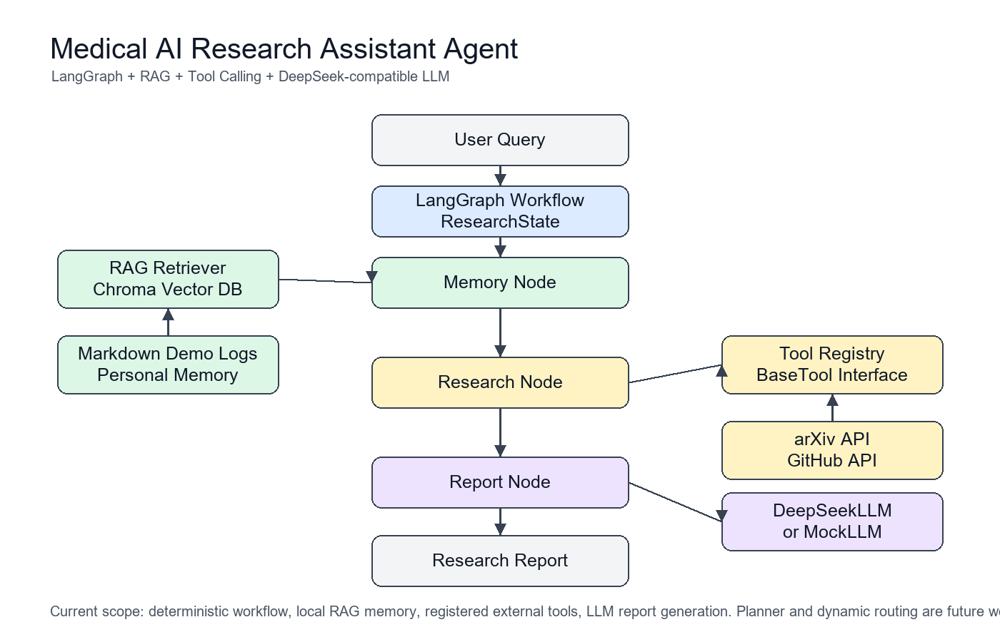

# Medical AI Research Assistant Agent

## Overview

Medical AI Research Assistant Agent is a research-oriented Agent system for medical AI and computer vision workflows.

It supports:

- Personal research knowledge management
- Literature retrieval
- Open-source project retrieval
- LLM-assisted research report generation

The project is built with:

- LangGraph
- RAG
- Tool Calling
- ChromaDB
- DeepSeek-compatible API integration

This is not a fully autonomous scientist or self-learning agent. It is a clear, modular research assistant workflow designed for local experimentation and portfolio demonstration.

## Architecture

See [docs/architecture.md](docs/architecture.md) for a detailed explanation.



```text
User Query
  |
  v
LangGraph Workflow
  |
  v
Memory Node -> RAG Retriever -> Chroma Vector Database
  |
  v
Research Node -> Tool Registry -> arXiv API / GitHub API
  |
  v
Report Node -> DeepSeek-compatible LLM -> Research Report
```

The architecture follows a State-Node-Tool pattern:

- State manages execution context.
- Node performs one workflow step.
- Tool provides external capabilities.
- RAG retrieves personal research memory.
- LLM fuses evidence into a structured report.

## Features

### Personal Research Memory

Builds a local research memory from Markdown notes using a RAG pipeline and ChromaDB persistence.

### External Research Tools

Supports external research lookup through standardized tools:

- arXiv paper search
- GitHub repository search

### LLM-based Report Generation

Generates structured Markdown research reports through a DeepSeek-compatible LLM layer. If no API key is configured, the project falls back to `MockLLM` for local demos.

### LangGraph Workflow

Uses a simple LangGraph State-Node workflow to organize retrieval, tool calling, and report generation.

## Demo

Example query:

```text
Summarize recent StereoVLA-related research progress.
```

Example reports:

- [StereoVLA Research Report](examples/demo_reports/stereo_vla_research_report.md)
- [Medical Vision Trend Report](examples/demo_reports/medical_vision_trend_report.md)
- [World Model Analysis Report](examples/demo_reports/world_model_analysis_report.md)

Screenshot placeholder:

- [docs/screenshots/README.md](docs/screenshots/README.md)

## Installation

1. Clone the repository:

```bash
git clone https://github.com/RoastDuckology/medical-research-agent-syf.git
cd medical-research-agent-syf
```

2. Create and activate a virtual environment:

```bash
python -m venv .venv
.venv\Scripts\Activate.ps1
```

3. Install dependencies:

```bash
pip install -r requirements.txt
```

4. Configure environment variables:

```bash
copy .env.example .env
```

5. Run the demo:

```bash
python app.py
```

6. Run the web demo:

```bash
streamlit run frontend/streamlit_app.py
```

7. Run tests:

```bash
pytest
```

## Web Demo

The Streamlit web demo provides a lightweight interface for the existing Agent workflow.

```bash
streamlit run frontend/streamlit_app.py
```

The page shows:

- Query
- Retrieved Memory
- External Research
- Final Report

The frontend does not call Chroma, arXiv, GitHub, or DeepSeek directly. It invokes the existing LangGraph workflow and renders the returned state.

## Streamlit Cloud Deployment

This repository can be deployed on Streamlit Cloud with the existing frontend entry point:

```text
frontend/streamlit_app.py
```

Deployment steps:

1. Push this repository to GitHub.
2. Open Streamlit Cloud and create a new app.
3. Select the GitHub repository.
4. Set the main file path to:

```text
frontend/streamlit_app.py
```

5. Add secrets or environment variables in Streamlit Cloud settings:

```text
DEEPSEEK_API_KEY="your-api-key"
DEEPSEEK_BASE_URL="https://api.deepseek.com"
LLM_MODEL="deepseek-chat"
GITHUB_TOKEN=""
VECTOR_DB_PATH="data/vector_db"
LOGS_DIR="data/demo_logs"
```

6. Deploy the app.

Do not commit `.env` or real API keys. For public demos without a DeepSeek key, the app falls back to `MockLLM`.

## Configuration

Key environment variables:

```text
DEEPSEEK_API_KEY=""
DEEPSEEK_BASE_URL="https://api.deepseek.com"
LLM_MODEL="deepseek-chat"
GITHUB_TOKEN=""
VECTOR_DB_PATH="data/vector_db"
LOGS_DIR="data/demo_logs"
```

Do not upload real API keys. `.env` is ignored by `.gitignore`.

## Project Structure

```text
agent/      LangGraph state, graph, workflow, and nodes
rag/        Markdown loader, splitter, embeddings, Chroma vector store, retriever
tools/      Tool interface, registry, arXiv tool, GitHub tool
llm/        Base LLM interface, MockLLM, DeepSeek-compatible provider
config/     Environment-based settings
data/       Demo logs and local vector database path
examples/   Example generated reports
docs/       Architecture documentation and visual assets
frontend/   Streamlit web demo layer
tests/      Unit tests for LLM, RAG, tools, and workflow
```

## Future Work

Planned improvements:

- Planner-based routing
- Dynamic tool selection
- Richer web interface
- PDF ingestion
- Better source citation formatting
- Evaluation scripts for retrieval and report quality

These are future plans and are not implemented in the current version.
